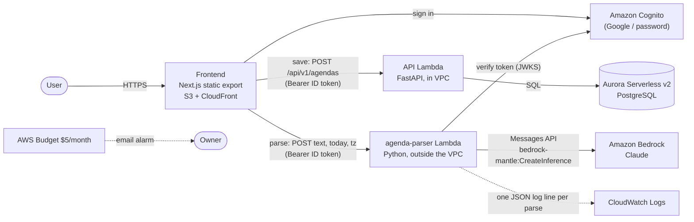

# Architecture

C4 level 2 (containers), updated for Lab 6: the agenda-parser function, Bedrock, and the two
new arrows, **parse** and **save**. Earlier labs' containers (reports pipeline, CloudFront)
are included for context.

The parser never touches the database and never writes: it returns JSON to the browser. The
browser pre-fills the agenda form, and **save** goes through the normal API with its usual
validation, together with the model's suggestion (`agendas.ai_suggestion`). See
[ADR 0006](adr/0006-llm-agenda-parsing.md).
